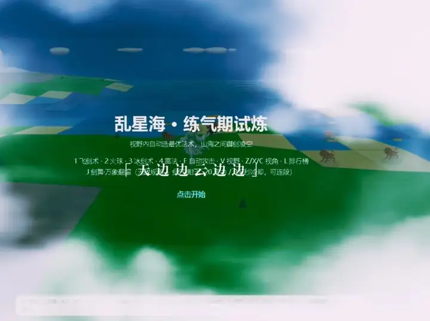
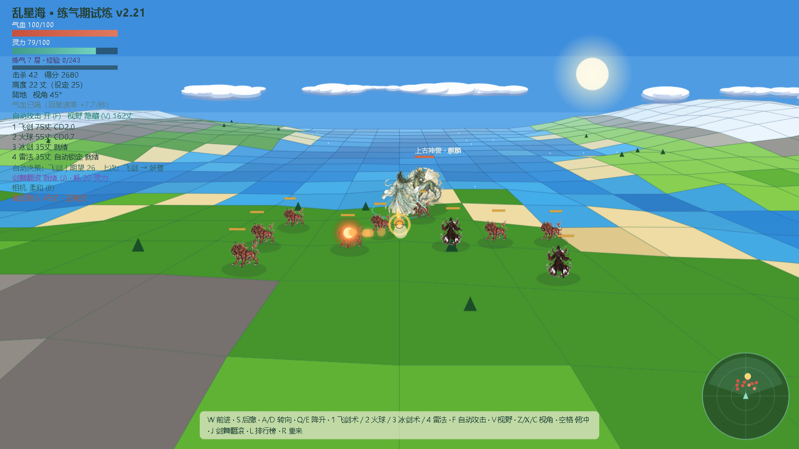
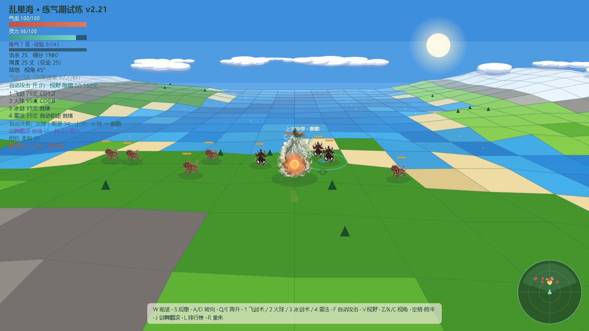
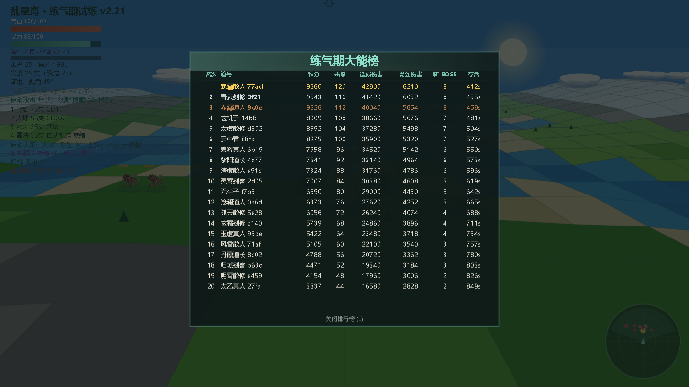
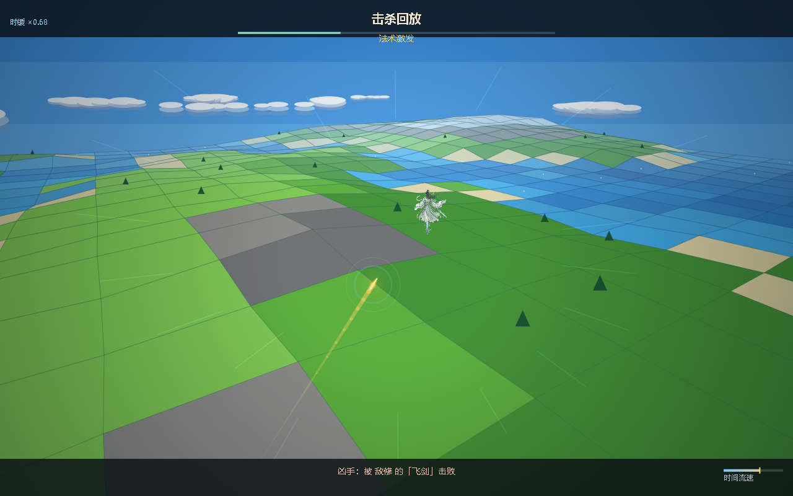
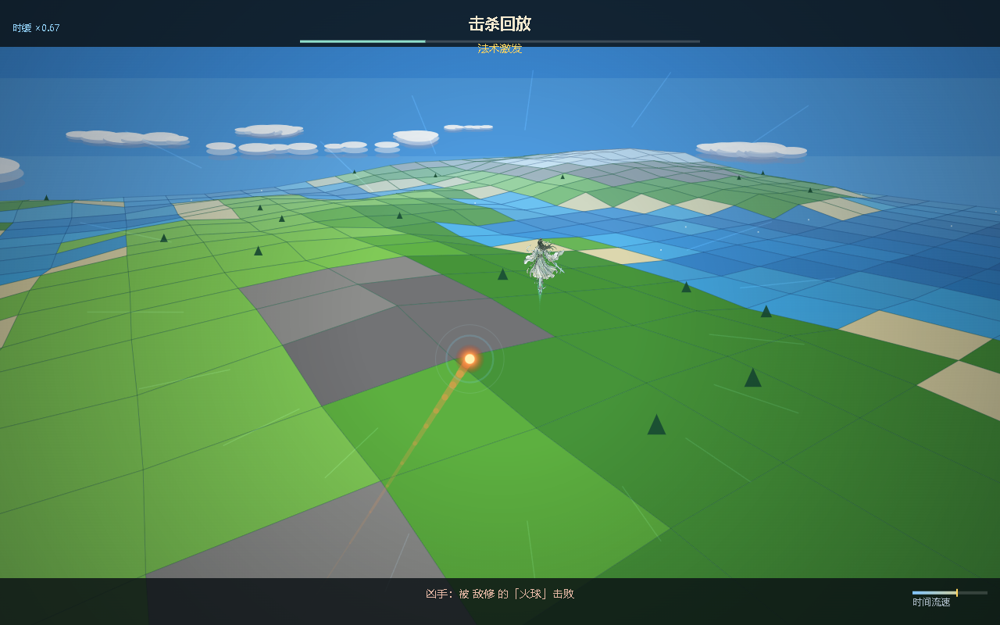
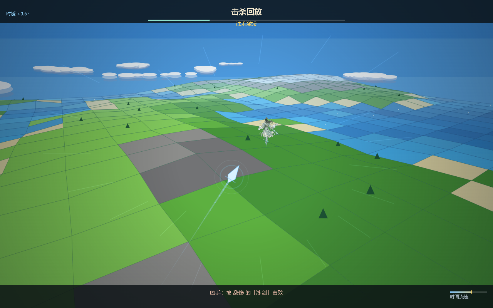

# 乱星海 · 练气期试炼

**御剑凌空 · 山海之间自动斗法** — 一个零依赖、单文件的伪 3D 仙侠空对地射击游戏。双击 HTML 即可开玩。

**Chaos Sea · Qi Refining Trial** — A zero-dependency, single-file pseudo-3D xianxia air-to-ground shooter. Double-click the HTML and play.

---

## 🎮 在线试玩 / Play Online

**[点此直接开玩 →](https://xianjian-kongduodi.app.workbuddy.host/?sharecode=ASJWDZ6E6D)**

> 无需安装、无需登录。首次加载约 9 MB 素材（5 张精灵图），稍候即可。
> No install, no login. First load pulls ~9 MB of sprite assets — just wait a moment.

### 🎬 演示视频 / Demo Video

[](https://v.douyin.com/UfRGpBa4j5A/)

*点击封面跳转抖音观看完整演示 / Click the cover to watch the full demo on Douyin*

---

## 📸 游戏截图 / Screenshots

### 战斗画面 / Gameplay



### 麒麟 Boss 战 / Qilin Boss Fight



### 练气期大能榜 / Leaderboard



### 击杀回放（复用本体法术特效）/ Kill Cam (actual spell VFX)

飞剑 / 火球 / 冰剑三种法术在回放里保持各自的本体外形与拖尾配色。
The kill cam reuses the in-game spell rendering — sword, fireball, and ice blade each keep their own shape and trail color.

| 飞剑 Sword | 火球 Fireball | 冰剑 Ice Blade |
|---|---|---|
|  |  |  |

---

## ✨ 特性 / Features

| 中文 | English |
|---|---|
| **伪 3D 飞行** — 方格山海地形、云层、日照、越肩追尾相机 | **Pseudo-3D flight** — tiled terrain, clouds, sunlight, over-the-shoulder camera |
| **技能系统** — 四种功法各有独立数值与弹道：飞剑（单体重击）、火球（范围爆炸）、冰剑（三连散射）、雷法（广域连锁，敌群越多越强） | **Skill system** — four spells with distinct stats & trajectories: sword (single-target burst), fireball (AoE explosion), ice blade (3-shot spread), lightning (area chain, stronger in crowds) |
| **自动追踪** — 飞剑/火球带制导，锁定最近目标；雷法自动瞄准敌群中心 | **Auto-tracking** — sword & fireball are homing and lock the nearest target; lightning auto-aims at the enemy cluster center |
| **导弹轨迹** — 飞剑走三段式弹道：冷发射垂直弹射 → 点火有限角速度转向 → 持续加速冲刺，带分段喷焰 | **Missile trajectory** — the sword uses a 3-stage flight: cold-launch eject → limited-rate turn after ignition → accelerating dash, with stage-specific exhaust |
| **机动躲避** — `J` 剑舞·万象翻滚：横滚 360° 剑光护体（全程短无敌）+ 桶滚剑气横扫 + 半筋斗抢高度，可连段；`空格` 俯冲突进 | **Evasive maneuvers** — `J` Sword Dance roll: 360° barrel roll with sword-energy shield (brief invulnerability) + sweeping slash + half-loop climb, chainable; `Space` for a dive |
| **自动斗法** — `F` 键切换自动攻击，按射程/敌群密度实时评分选法术与索敌 | **Auto-cast** — press F to auto-fight; picks spells and targets by live scoring of range and enemy clustering |
| **练气期大能榜** — 8 维度战绩、本机持久化、L 键随时查看、道消后自动展示 | **Leaderboard** — 8 stats, local persistence, press L anytime, auto-shown on death |
| **击杀回放（Kill Cam）** — 子弹时间 + 第三视角，真实还原致命一击的法术 | **Kill Cam** — bullet-time third-person replay of the fatal blow with the actual spell |
| **麒麟 Boss 分段重生** — 每 5 次击杀刷出一只，同屏最多一只 | **Qilin boss respawn** — one boss per 5 kills, at most one on screen |
| **触屏适配** — 手机端虚拟摇杆与按钮 | **Touch support** — virtual joystick and buttons on mobile |

### 技能机制详解 / Spell Mechanics

| 技能 Spell | 定位 Role | 弹道 / 制导 Trajectory & Guidance |
|---|---|---|
| **飞剑术 / Sword** | 单体重击，26 伤害 / 2 秒 CD<br>Single-target burst, 26 dmg / 2s CD | **导弹式三段弹道**：垂直冷发射 → 点火转向 → 加速冲刺；锁定最近目标<br>**3-stage missile trajectory**: vertical cold launch → ignition turn → accelerating dash; locks nearest target |
| **火球 / Fireball** | 范围爆炸，半径 12 丈 / 0.8 秒 CD<br>AoE explosion, 12 zhang radius / 0.8s CD | 制导追踪 + 落点范围伤害<br>Homing guidance + area damage on impact |
| **冰剑术 / Ice Blade** | 三连散射，14×3 伤害 / 0.7 秒 CD<br>3-shot spread, 14×3 dmg / 0.7s CD | 无制导直线三连，近距离覆盖<br>Unguided straight 3-shot, close-range coverage |
| **雷法 / Lightning** | 广域连锁，半径 14 丈 / 2 秒 CD<br>Wide-area chain, 14 zhang radius / 2s CD | 自动瞄准敌群中心；每多命中一个目标，连锁伤害 +60%<br>Auto-aims at enemy cluster center; +60% chain damage per extra target hit |

> 开启自动斗法（`F`）后，游戏会实时按射程与敌群密度评分选法术：
> 散兵用火球/冰剑，3 个以上聚团则优先雷法。
> With auto-cast (`F`) on, spells are chosen by live scoring: fireball/ice for scattered foes, lightning for clusters of 3+.

---

## 🕹️ 操作 / Controls

| 按键 Key | 功能 Action |
|---|---|
| `W` / `S` | 前进 / 后撤 · Forward / Back |
| `A` / `D` | 转向 · Steer |
| `Q` / `E` | 降 / 升 · Descend / Ascend |
| `1` `2` `3` `4` | 飞剑术 / 火球 / 冰剑术 / 雷法 · Sword / Fireball / Ice Blade / Lightning |
| `F` | 自动攻击开关 · Toggle auto-cast |
| `V` | 显示 / 隐藏视野 · Toggle vision range |
| `Z` `X` `C` | 切换相机视角 · Camera angles |
| `空格` Space | 俯冲 · Dive |
| `J` | 剑舞翻滚（可连段）· Sword-dance roll (chainable) |
| `L` | 打开 / 关闭排行榜（↑↓ 翻页）· Toggle leaderboard (↑↓ to page) |
| `R` | 重来 · Restart |

---

## 🚀 本地运行 / Run Locally

**最简单 / Simplest**: 直接用浏览器打开 `scripts/mvp_air_to_ground.html`。
Just open `scripts/mvp_air_to_ground.html` in a browser.

**用本地服务器 / With a local server**（推荐用于开发 / recommended for dev）:

```bash
cd <仓库根目录 / repo root>
python -m http.server 8000
# 浏览 / open http://127.0.0.1:8000/scripts/mvp_air_to_ground.html
```

> 素材位于 `scripts/assets/`，通过相对路径加载，无需构建步骤。
> Sprites live in `scripts/assets/` and load via relative paths — no build step.

---

## 📁 项目结构 / Project Structure

```
scripts/
  mvp_air_to_ground.html   # 游戏本体，全部逻辑与样式内联 / the whole game
  assets/                  # 精灵图资源 / sprite assets
  *_test*.js               # CDP 自动化测试 / CDP-based automated tests
  _testlib.js              # 测试公共库 / shared test helpers
docs/
  011_MVP交付说明_御剑空对地.md  # 完整交付说明（中文）/ full delivery doc (Chinese)
  screenshots/             # 本 README 使用的截图 / screenshots used in this README
```

---

## 📚 文档 / Documentation

- [007 用户原始需求落盘](docs/007_需求落盘_仙侠剑仙游戏.md) — 对话输入第一时间留档 · Raw user requirements, captured verbatim
- [008 仙侠剑仙游戏调研报告](docs/008_仙侠剑仙游戏调研报告.md) — 御剑探索 × 空间战术 × 宗门经营 · Sword-flight exploration × spatial tactics × sect management
- [009 路线 B 实施规格](docs/009_路线B实施规格.md) — 真 3D 舞台 + 3D 空间切片体单位 · True-3D stage + 3D spatial-slice units
- [010 产品设计方案](docs/010_产品设计方案_仙侠剑仙游戏.md) — GDD 简版 · Lightweight game design document
- [011 MVP 交付说明](docs/011_MVP交付说明_御剑空对地.md) — 设计、迭代、验证全记录 · Full design, iteration and verification log
- [012 Forge 地形云层移植分析](docs/012_Forge地形云层移植分析.md) — 地形与云层移植方案 · Terrain and cloud-layer porting analysis

---

## 🧪 测试 / Tests

全套 CDP 自动化测试覆盖战斗、排行榜、安全加固、Kill Cam 等，共 **204 项断言全部通过**。
The full CDP-based suite covers combat, leaderboard, security hardening, and kill cam — **204 assertions, all passing**.

```bash
node scripts/28_test_v221.js   # Kill Cam 法术特效专项 / kill cam spell VFX
node scripts/26_test_v220.js   # 排行榜分页 / leaderboard paging
node scripts/24_test_v219.js   # 排行榜安全 / leaderboard security
```

> 需要本地已启动 CDP 调试浏览器（端口 9223）与静态服务器（端口 8000）。
> Requires a CDP-enabled browser on port 9223 and a static server on port 8000.

---

当前版本 **v2.21**。线上与本地 `file://` 版本为同一份代码，行为一致。
Current version: **v2.21**. The online build and the local `file://` build are the same code.
